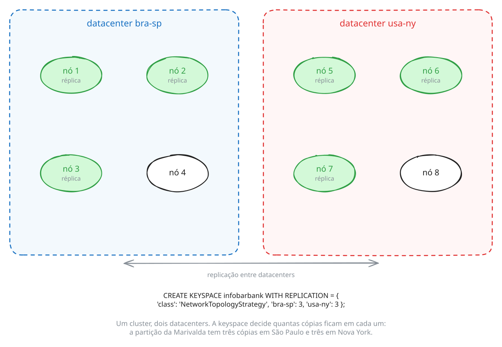
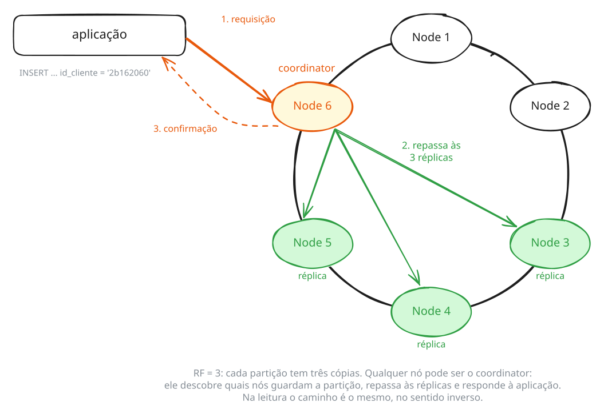
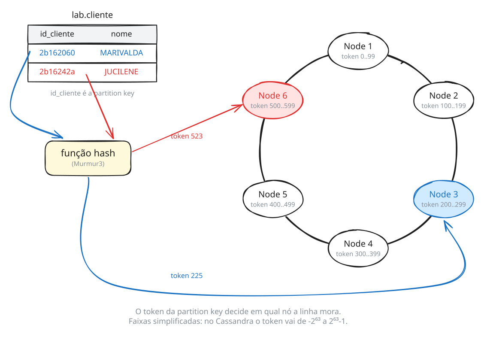

# Administração e Propriedades de Cluster com Apache Cassandra 5

Author: Prof. Barbosa<br>
Contact: infobarbosa@gmail.com<br>
Github: [infobarbosa](https://github.com/infobarbosa)

No laboratório [cassandra-widecolumn-demo](https://github.com/infobarbosa/cassandra-widecolumn-demo), o foco é o modelo de dados wide-column e a modelagem orientada a consultas em um único nó. Aquilo que lá precisou ficar no papel — **replicação multi-datacenter entre racks, escolha do coordinator, níveis de consistência locais e globais sob falha (`LOCAL_QUORUM`, `QUORUM`, `EACH_QUORUM`), hinted handoff, read repair e anti-entropia com `nodetool repair`** — é o assunto deste laboratório, agora sobre um **cluster real de 6 nós Apache Cassandra 5 distribuídos em 2 datacenters e 3 racks por datacenter**.

Os comandos são copy-paste no terminal do laboratório, na ordem em que aparecem.

---

## O que você vai saber fazer ao final

- Inspecionar a topologia física e lógica de um cluster multi-datacenter sem mestre (*peer-to-peer*), distinguindo o que cada nó sabe sobre si (`system.local`) e sobre os outros 5 vizinhos (`system.peers_v2`).
- Explicar o papel dos **seed nodes** (um por datacenter), do protocolo **Gossip** (`nodetool gossipinfo`) e do **Snitch** (`GossipingPropertyFileSnitch`) na distribuição de réplicas entre datacenters e racks.
- Ler o **ring de tokens** (`nodetool status`, `nodetool ring`, `nodetool describering`) e verificar como os **vnodes** (`num_tokens: 16`) dividem o espaço do `Murmur3Partitioner` em cada datacenter.
- Comparar na prática estratégias de replicação com `NetworkTopologyStrategy` em múltiplos datacenters, localizando em quais nós e arquivos de disco (`SSTables`) cada partição mora (`nodetool getendpoints`).
- Observar qualquer nó atuando como **coordinator** de uma consulta (`TRACING ON`), mesmo quando ele não guarda cópia daquela partição.
- Demonstrar na prática a equação de consistência forte (**$R + W > RF$**) e a diferença crucial entre **`LOCAL_QUORUM`**, **`QUORUM`** e **`EACH_QUORUM`**, desligando 1 nó, 2 nós e **um datacenter inteiro (`datacenter2`)** sem interromper a operação do `datacenter1`.
- Observar e medir os três mecanismos de convergência e autocura do Cassandra:
  1. **Hinted Handoff** (`nodetool statushandoff`, arquivos em `/var/lib/cassandra/nodeN/hints`);
  2. **Read Repair** (provocando uma réplica defasada e vendo uma leitura com `TRACING ON` consertá-la em tempo real);
  3. **Anti-Entropia Ativa** (`nodetool repair` com árvores de Merkle) e a relação crítica entre `DELETE`, **tombstones** e `gc_grace_seconds`.
- Operar o ciclo de vida de nós com `nodetool` (`drain`, `tpstats`, `netstats`, `compactionstats`, `tablestats`) e distinguir parada limpa (`node-stop`) de queda abrupta (`node-kill` com *commitlog replay*).

---

## Pré-requisitos

- Acesso ao **AWS Academy** (o ambiente é uma instância EC2 de **8 GB de RAM** criada pelo script `launch-lab.sh`, logo a seguir).
- Um navegador. Nada precisa ser instalado: o `cqlsh`, o `nodetool` e os utilitários de controle dos 6 nós (`node-start`, `node-stop`, `node-kill`, `nodetool1` a `nodetool6`) já vêm prontos no ambiente.

Fora da aula, o mesmo ambiente roda em qualquer máquina com **Docker** e **8 GB de RAM** — veja o [Apêndice D](#d-execução-local).

---

## Índice

[O ambiente](#o-ambiente)

**Parte 1 — Topologia Multi-Datacenter, Gossip e o Anel de Tokens**

1. [Um cluster de 6 nós em 2 datacenters sem mestre](#1-um-cluster-de-6-nós-em-2-datacenters-sem-mestre)
2. [O anel de tokens (Ring) e Vnodes](#2-o-anel-de-tokens-ring-e-vnodes)

**Parte 2 — Replicação Física Multi-DC e Posicionamento no Disco**

3. [Fator de replicação na prática: Single-DC vs Multi-DC](#3-fator-de-replicação-na-prática-single-dc-vs-multi-dc)

**Parte 3 — Coordenação, Níveis de Consistência e Queda de Datacenter**

4. [Qualquer nó é Coordinator](#4-qualquer-nó-é-coordinator)
5. [Níveis de consistência sob falha ($R + W > RF$) e `LOCAL_QUORUM` vs `QUORUM`](#5-níveis-de-consistência-sob-falha-r--w--rf-e-local_quorum-vs-quorum)

**Parte 4 — Autocura e Anti-Entropia**

6. [Hinted Handoff: quando a falha é breve](#6-hinted-handoff-quando-a-falha-é-breve)
7. [Read Repair: consertando réplicas na leitura](#7-read-repair-consertando-réplicas-na-leitura)
8. [Nodetool Repair, Tombstones e Dados Zumbis](#8-nodetool-repair-tombstones-e-dados-zumbis)

**Parte 5 — Operação e Manutenção do Cluster**

9. [Operação no dia a dia: Drain, Crash Recovery e Telemetria](#9-operação-no-dia-a-dia-drain-crash-recovery-e-telemetria)

**Apêndices**

- [A. Referência rápida de comandos do cluster](#a-referência-rápida-de-comandos-do-cluster)
- [B. Encerrando o ambiente](#b-encerrando-o-ambiente)
- [C. Troubleshooting](#c-troubleshooting)
- [D. Execução local](#d-execução-local)

---

## O ambiente

O laboratório roda em uma instância **AWS EC2 com 8 GB de RAM** (`t3.large`, `t3a.large`, `t2.large` ou `m5.large` — validada automaticamente via AWS API pelo `launch-lab.sh`) criada a partir do **AWS CloudShell**. A instância executa um container com o **code-server** (Visual Studio Code no navegador) e um **cluster de 6 nós Apache Cassandra 5.0** (`127.0.0.1` a `127.0.0.6`), divididos em **2 datacenters (`datacenter1` e `datacenter2`)** com **3 racks por datacenter (`RAC1`, `RAC2` e `RAC3`)**, e com as keyspaces `infobarbank` e `infobarshop` carregadas com fator de replicação **3 por datacenter** (6 réplicas no total).



> **ATENÇÃO:**
> 1. **Região:** utilize sempre a região **Norte da Virgínia (`us-east-1`)** no Console AWS.
> 2. **Memória Obrigatória (8 GB):** os 6 processos Cassandra + IDE consomem cerca de 4,5 GB a 5,0 GB de RAM. O script `launch-lab.sh` restringe a criação exclusivamente a tipos EC2 com **8 GiB (8192 MiB)** de memória.
> 3. **Custos:** a instância EC2 e o volume EBS consomem créditos do seu laboratório AWS Academy. Ao encerrar a aula, garanta que a instância esteja parada (**Stopped**) ou aguarde o desligamento automático da sessão.
> 4. **Não recrie a máquina para continuar o trabalho:** cada execução do `launch-lab.sh` cria uma instância **nova e vazia**, com data e hora no nome. Se a sua instância já existir, siga as instruções de [Retomando o laboratório](#retomando-o-laboratório).

### Passo 1: Abrir o AWS CloudShell

1. Faça login no Console da AWS através do seu painel do AWS Academy.
2. Certifique-se de que a região selecionada no canto superior direito é **N. Virginia (`us-east-1`)**.
3. No topo do console, clique no ícone do **AWS CloudShell** (`>_`) ao lado da barra de pesquisa.
4. Aguarde o terminal do CloudShell carregar.

### Passo 2: Executar o script de provisionamento

No terminal do CloudShell, execute:

```sh
curl -sS https://raw.githubusercontent.com/infobarbosa/cassandra-cluster-administration/main/launch-lab.sh | bash

```

O script realiza de forma automatizada:

- Descoberta da VPC padrão e validação via AWS API de um tipo de instância com exatamente **8 GiB (8192 MiB) de RAM** disponível na região.
- Configuração do Security Group `lab-cassandra-sg`, liberando as portas `8080` (IDE) e `22` (SSH).
- Lançamento de uma nova instância EC2 `lab-cassandra-cluster-AAAA-MM-DD_HH_MI_SS` (Ubuntu 24.04, 8 GB RAM, 20 GB gp3).
- Instalação do Docker e inicialização do container `cassandra-cluster-lab` (code-server + cluster de 6 nós Cassandra).
- Exibição do IP público e do link de acesso.

### Passo 3: Acessar a IDE

1. Abra no navegador o link exibido ao final do script: `http://<IP-PUBLICO>:8080`.
2. Caso a página não responda, **aguarde de 2 a 4 minutos** para que o Docker conclua o download da imagem e atualize o navegador.
3. O code-server abre diretamente na IDE, sem solicitar senha.
4. Abra um terminal: menu superior (três linhas horizontais) > **Terminal** > **New Terminal**.

> **Atenção!** Todos os comandos deste laboratório são executados no **terminal do code-server**. O CloudShell só serve para criar a instância.

### Retomando o laboratório

Se a sessão do AWS Academy expirar, a instância será parada. **Não execute o `launch-lab.sh` novamente:** ele criaria uma instância nova.

1. No Console AWS (`us-east-1`), acesse **EC2** > **Instances**.
2. Selecione a sua instância **`lab-cassandra-cluster-<data e hora>`** e clique em **Instance state** > **Start instance**.
3. Aguarde o status **Running** e copie o novo **Public IPv4 address**.
4. Acesse `http://<NOVO_IP_PUBLICO>:8080`.

### O que acontece na subida do container

O anel de 6 nós (nos 2 datacenters) e os dados das keyspaces `infobarbank` e `infobarshop` (`RF=3` em cada datacenter) já vêm **pré-inicializados e gravados em SSTables dentro da imagem Docker**. Graças a isso, o container não precisa fazer bootstrap sequencial nem recarregar dados no boot: ele dispara **os 6 nós em paralelo** e todo o cluster fica `UN` em cerca de **30 a 45 segundos**.

Acompanhe pelo log de inicialização:

```sh
cat /var/log/lab/carga.log

```

```
[node1] Iniciado em background (IP 127.0.0.1, JMX 7199, log: /var/log/lab/cassandra-node1.log).
[node2] Iniciado em background (IP 127.0.0.2, JMX 7200, log: /var/log/lab/cassandra-node2.log).
[node3] Iniciado em background (IP 127.0.0.3, JMX 7201, log: /var/log/lab/cassandra-node3.log).
[node4] Iniciado em background (IP 127.0.0.4, JMX 7202, log: /var/log/lab/cassandra-node4.log).
[node5] Iniciado em background (IP 127.0.0.5, JMX 7203, log: /var/log/lab/cassandra-node5.log).
[node6] Iniciado em background (IP 127.0.0.6, JMX 7204, log: /var/log/lab/cassandra-node6.log).
[carga] node1 (127.0.0.1) pronto (UN).
[carga] node2 (127.0.0.2) pronto (UN).
[carga] node3 (127.0.0.3) pronto (UN).
[carga] node4 (127.0.0.4) pronto (UN).
[carga] node5 (127.0.0.5) pronto (UN).
[carga] node6 (127.0.0.6) pronto (UN).
[carga] Cluster de 6 nos pronto:
[...]
[carga] Keyspaces infobarbank e infobarshop ja pre-carregadas na imagem.
Keyspaces prontas.
[carga] Iniciando o app infobarBank (log: /var/log/lab/app.log).
```

Se o arquivo ainda não tiver chegado em `Keyspaces prontas.`, aguarde alguns segundos e repita o comando.

### Verificando o ambiente

Assim que a carga terminar, confira a integridade do cluster de 6 nós:

```sh
curl -sS https://raw.githubusercontent.com/infobarbosa/cassandra-cluster-administration/main/scripts/check.sh | bash

```

```
Memória da Máquina
  ✓ Memória RAM detectada: 7850 MB (compatível com o requisito de 8 GB)

Ferramentas
  ✓ cqlsh
  ✓ nodetool
  ✓ nodetool1
  ✓ nodetool2
  ✓ nodetool3
  ✓ nodetool4
  ✓ nodetool5
  ✓ nodetool6
  ✓ node-start
  ✓ node-stop
  ✓ node-kill
  ✓ sstabledump

Carga inicial do cluster
  ✓ bootstrap dos 6 nós e carga do primeiro boot concluídos

Nós do cluster (datacenter1 e datacenter2)
  ✓ node1 (127.0.0.1, datacenter1, RAC1): UN (Up/Normal)
  ✓ node2 (127.0.0.2, datacenter1, RAC2): UN (Up/Normal)
  ✓ node3 (127.0.0.3, datacenter1, RAC3): UN (Up/Normal)
  ✓ node4 (127.0.0.4, datacenter2, RAC1): UN (Up/Normal)
  ✓ node5 (127.0.0.5, datacenter2, RAC2): UN (Up/Normal)
  ✓ node6 (127.0.0.6, datacenter2, RAC3): UN (Up/Normal)
  ✓ Cassandra versão 5.0.9

Keyspaces e Replicação Multi-DC
  ✓ infobarbank: 12 tabelas (NetworkTopologyStrategy, datacenter1 = 3, datacenter2 = 3)
  ✓ infobarshop: 9 tabelas (NetworkTopologyStrategy, datacenter1 = 3, datacenter2 = 3)

Dados
  ✓ infobarbank.cliente: 50 clientes
  ✓ infobarshop.pedido_detalhe: 12004 pedidos

Resultado
  Cluster de 6 nós pronto para o laboratório.
```

### Mapa dos 6 nós e ferramentas do laboratório

Neste ambiente, os 6 nós rodam em processos isolados dentro do mesmo container, permitindo inspecionar configurações, logs e arquivos de dados dos 6 servidores lado a lado:

| Nó | Datacenter | Rack | Endereço IP (CQL `:9042` / Gossip `:7000`) | Porta JMX | Atalho `nodetool` | Configuração | Dados (`SSTables`, `hints`, `commitlog`) |
|---|---|---|---|---|---|---|---|
| **`node1`** *(Seed)* | `datacenter1` | `RAC1` | `127.0.0.1` | `7199` | `nodetool1` (ou `nodetool`) | `/etc/cassandra/node1` | `/var/lib/cassandra/node1` |
| **`node2`** | `datacenter1` | `RAC2` | `127.0.0.2` | `7200` | `nodetool2` | `/etc/cassandra/node2` | `/var/lib/cassandra/node2` |
| **`node3`** | `datacenter1` | `RAC3` | `127.0.0.3` | `7201` | `nodetool3` | `/etc/cassandra/node3` | `/var/lib/cassandra/node3` |
| **`node4`** *(Seed)* | `datacenter2` | `RAC1` | `127.0.0.4` | `7202` | `nodetool4` | `/etc/cassandra/node4` | `/var/lib/cassandra/node4` |
| **`node5`** | `datacenter2` | `RAC2` | `127.0.0.5` | `7203` | `nodetool5` | `/etc/cassandra/node5` | `/var/lib/cassandra/node5` |
| **`node6`** | `datacenter2` | `RAC3` | `127.0.0.6` | `7204` | `nodetool6` | `/etc/cassandra/node6` | `/var/lib/cassandra/node6` |

Para simular operações de manutenção e quedas de servidor, rack ou datacenter durante a aula, você tem três comandos utilitários no `PATH`:

- `node-stop <1..6>` — descarrega as memtables em disco (`nodetool drain`) e para o nó de forma limpa;
- `node-kill <1..6>` — mata o processo do nó abruptamente (`kill -9`, sem `drain`), simulando queda de energia ou perda de máquina;
- `node-start <1..6>` — inicia novamente o nó em segundo plano.

---

# Parte 1 — Topologia Multi-Datacenter, Gossip e o Anel de Tokens

## 1. Um cluster de 6 nós em 2 datacenters sem mestre

No Cassandra não existe nó primário, *master* ou *name node*: todos os 6 nós executam exatamente o mesmo binário e têm o mesmo papel, quer estejam no `datacenter1` ou no `datacenter2`. Qualquer nó pode receber conexões de clientes e coordenar leituras ou escritas.



### 1.a. O ponto de vista do operador: `nodetool status`

Peça ao `node1` o estado atual do cluster:

```sh
# 1.a.1
nodetool status

```

```
Datacenter: datacenter1
=======================
Status=Up/Down
|/ State=Normal/Leaving/Joining/Moving
--  Address    Load        Tokens  Owns (effective)  Host ID                               Rack
UN  127.0.0.3  130.17 KiB  16      100.0%            4e25811e-f98e-40ea-9a7f-579a62ce0728  RAC3
UN  127.0.0.2  80.06 KiB   16      100.0%            3cb14774-e000-4dbf-bf41-205a9f206e8b  RAC2
UN  127.0.0.1  1.33 MiB    16      100.0%            8e9b590e-48ab-43be-bd42-ad2b9fb1295b  RAC1

Datacenter: datacenter2
=======================
Status=Up/Down
|/ State=Normal/Leaving/Joining/Moving
--  Address    Load        Tokens  Owns (effective)  Host ID                               Rack
UN  127.0.0.6  112.40 KiB  16      100.0%            a1c2d3e4-1111-4abc-8def-1234567890ab  RAC3
UN  127.0.0.5  95.12 KiB   16      100.0%            b2d3e4f5-2222-4abc-8def-1234567890ab  RAC2
UN  127.0.0.4  128.50 KiB  16      100.0%            c3e4f5a6-3333-4abc-8def-1234567890ab  RAC1
```

Observe como o `nodetool status` agrupa automaticamente a saída pelos dois datacenters (`datacenter1` e `datacenter2`):

- **`UN` (*Up / Normal*):** a primeira letra indica se o nó está vivo (`U` = *Up*, `D` = *Down*); a segunda indica o estado dele no anel (`N` = *Normal*, `J` = *Joining*, `L` = *Leaving*, `M` = *Moving*).
- **`Address`:** `127.0.0.1` a `127.0.0.3` no `datacenter1`; `127.0.0.4` a `127.0.0.6` no `datacenter2`.
- **`Tokens: 16`:** cada nó ocupa 16 posições (*vnodes*) no anel.
- **`Owns (effective): 100.0%`:** como as keyspaces carregadas (`infobarbank` e `infobarshop`) têm fator de replicação **3 em cada datacenter**, todos os 6 nós guardam 100% das partições dessas keyspaces (3 cópias no `datacenter1` + 3 cópias no `datacenter2`).
- **`Rack`:** dentro de cada datacenter, os 3 nós estão distribuídos em `RAC1`, `RAC2` e `RAC3`.

O comando `nodetool` conversa com um nó via **JMX** (por padrão na porta `7199`, que é a do `node1`). Os atalhos `nodetool1` a `nodetool6` apontam para as portas `7199` a `7204`. Confira que o `node4` (no `datacenter2`) enxerga exatamente o mesmo cluster:

```sh
# 1.a.2
nodetool4 status

```

### 1.b. O que cada nó sabe sobre si e sobre os vizinhos (`system.local` e `system.peers_v2`)

Cada nó mantém no seu próprio disco uma keyspace interna chamada `system`. Nela, duas tabelas descrevem a topologia sob o ponto de vista **daquele nó**:

- `system.local`: uma única linha — quem **eu** sou;
- `system.peers_v2` (e `system.peers`): quem são os **outros 5** nós do cluster.

Pergunte ao **`node1` (`127.0.0.1`, no `datacenter1`)**:

```sh
# 1.b.1
cqlsh 127.0.0.1 -e "
SELECT broadcast_address, data_center, rack, release_version FROM system.local;
SELECT peer, data_center, rack, schema_version FROM system.peers_v2;"

```

```
 broadcast_address | data_center | rack | release_version
-------------------+-------------+------+-----------------
         127.0.0.1 | datacenter1 | RAC1 |           5.0.9

(1 rows)

 peer      | data_center | rack | schema_version
-----------+-------------+------+--------------------------------------
 127.0.0.2 | datacenter1 | RAC2 | 22083a76-7c65-3f62-9755-68029f1a6f35
 127.0.0.3 | datacenter1 | RAC3 | 22083a76-7c65-3f62-9755-68029f1a6f35
 127.0.0.4 | datacenter2 | RAC1 | 22083a76-7c65-3f62-9755-68029f1a6f35
 127.0.0.5 | datacenter2 | RAC2 | 22083a76-7c65-3f62-9755-68029f1a6f35
 127.0.0.6 | datacenter2 | RAC3 | 22083a76-7c65-3f62-9755-68029f1a6f35

(5 rows)
```

Agora faça **exatamente a mesma pergunta**, mas conectando no **`node4` (`127.0.0.4`, no `datacenter2`)**:

```sh
# 1.b.2
cqlsh 127.0.0.4 -e "
SELECT broadcast_address, data_center, rack, release_version FROM system.local;
SELECT peer, data_center, rack, schema_version FROM system.peers_v2;"

```

Repare em dois detalhes importantes para a administração:

1. No `node4`, `system.local` é o `127.0.0.4` (`datacenter2`, `RAC1`), e o `127.0.0.1` aparece como mais um vizinho em `system.peers_v2`.
2. A coluna **`schema_version`** tem exatamente o mesmo UUID nos 6 nós. Sempre que você executa um `CREATE TABLE` ou `ALTER TABLE` em qualquer nó de qualquer datacenter, a definição se propaga pelo cluster inteiro e todos os 6 nós convergem para o mesmo `schema_version`.

Confira a visão consolidada do cluster com `nodetool describecluster`:

```sh
# 1.b.3
nodetool describecluster

```

```
Cluster Information:
	Name: infobarbosainc
	Snitch: org.apache.cassandra.locator.GossipingPropertyFileSnitch
	DynamicEndPointSnitch: enabled
	Partitioner: org.apache.cassandra.dht.Murmur3Partitioner
	Schema versions:
		22083a76-7c65-3f62-9755-68029f1a6f35: [127.0.0.1:7000, 127.0.0.2:7000, 127.0.0.3:7000, 127.0.0.4:7000, 127.0.0.5:7000, 127.0.0.6:7000]
```

### 1.c. Como os nós se encontram: Seeds por Datacenter, Snitch e Configs

Inspecione os arquivos de configuração dos 6 nós em `/etc/cassandra/node{1..6}`:

```sh
# 1.c.1
grep -E "^(cluster_name|endpoint_snitch|listen_address|rpc_address)|seeds:" \
    /etc/cassandra/node{1,2,3,4,5,6}/cassandra.yaml

```

E os arquivos de topologia (`cassandra-rackdc.properties`), lidos pelo `GossipingPropertyFileSnitch`:

```sh
# 1.c.2
head -n 5 /etc/cassandra/node{1,2,3,4,5,6}/cassandra-rackdc.properties

```

```
==> /etc/cassandra/node1/cassandra-rackdc.properties <==
dc=datacenter1
rack=RAC1
[...]
==> /etc/cassandra/node4/cassandra-rackdc.properties <==
dc=datacenter2
rack=RAC1
[...]
```

Observe a configuração dos **Seeds**:
- `seeds: "127.0.0.1:7000,127.0.0.4:7000"` — declaramos **um seed no `datacenter1` (`127.0.0.1`) e um seed no `datacenter2` (`127.0.0.4`)**. Em clusters multi-datacenter de produção, a boa prática é elencar 2 ou 3 seeds de cada datacenter na mesma lista `seeds:` de todos os nós, garantindo que o Gossip entre datacenters sempre tenha pontos de contato conhecidos, sem tornar nenhum nó "mestre".

### 1.d. O protocolo Gossip (`nodetool gossipinfo`)

A cada segundo, cada nó escolhe de um a três vizinhos (priorizando o datacenter local e os seeds, e periodicamente um nó do outro datacenter) e troca mensagens na porta `7000`. Veja o estado do Gossip nos 6 nós:

```sh
# 1.d.1
nodetool gossipinfo | grep -E "^/|generation:|heartbeat:|STATUS:|DC:|RACK:"

```

- **`generation`:** o timestamp de quando aquele nó **iniciou**.
- **`heartbeat`:** contador incrementado a cada segundo enquanto o nó está vivo, usado pelo detector de falhas (*Phi Accrual Failure Detector*).

---

## 2. O anel de tokens (Ring) e Vnodes

O Cassandra aplica a função de hash `Murmur3Partitioner` sobre a **partition key** de cada linha, gerando um inteiro de 64 bits entre $-2^{63}$ e $2^{63}-1$: o **token**.



### 2.a. Os 96 tokens do anel (`nodetool ring`)

Com 6 nós e `num_tokens: 16` por nó, o anel completo tem **96 faixas de tokens** (48 no `datacenter1` e 48 no `datacenter2`):

```sh
# 2.a.1
nodetool ring | grep -E "^(Datacenter:|127\.0\.0\.[1-6])" | awk '/^Datacenter:/ {print; next} {print $1, $2}' | uniq -c

```

Contando quantos tokens cada nó possui no seu respectivo datacenter:

```sh
# 2.a.2
nodetool ring | grep -E "^127\.0\.0\.[1-6]" | awk '{print $1, $2}' | sort | uniq -c

```

```
     16 127.0.0.1 RAC1
     16 127.0.0.2 RAC2
     16 127.0.0.3 RAC3
     16 127.0.0.4 RAC1
     16 127.0.0.5 RAC2
     16 127.0.0.6 RAC3
```

---

# Parte 2 — Replicação Física Multi-DC e Posicionamento no Disco

## 3. Fator de replicação na prática: Single-DC vs Multi-DC

Com a estratégia **`NetworkTopologyStrategy`**, cada keyspace declara independentemente **quantas cópias quer em cada datacenter**.


Vamos criar três keyspaces de experimento para comparar o posicionamento das réplicas:
1. **`lab_dc1_rf1`** (`'datacenter1': 1` — apenas 1 cópia no `datacenter1`, e **0 cópias no `datacenter2`**);
2. **`lab_multi_rf2`** (`'datacenter1': 2, 'datacenter2': 1` — 2 cópias no `datacenter1` e 1 cópia no `datacenter2`);
3. **`lab_multi_rf3`** (`'datacenter1': 3, 'datacenter2': 3` — 3 cópias em cada datacenter, igual a `infobarbank` e `infobarshop`).

### 3.a. Criando as keyspaces e inserindo a cliente Marivalda (`2b162060`)

```sh
# 3.a.1
cqlsh 127.0.0.1 -e "
CREATE KEYSPACE IF NOT EXISTS lab_dc1_rf1
    WITH replication = {'class': 'NetworkTopologyStrategy', 'datacenter1': 1};

CREATE KEYSPACE IF NOT EXISTS lab_multi_rf2
    WITH replication = {'class': 'NetworkTopologyStrategy', 'datacenter1': 2, 'datacenter2': 1};

CREATE KEYSPACE IF NOT EXISTS lab_multi_rf3
    WITH replication = {'class': 'NetworkTopologyStrategy', 'datacenter1': 3, 'datacenter2': 3};

CREATE TABLE IF NOT EXISTS lab_dc1_rf1.cliente (id_cliente text PRIMARY KEY, nome text);
CREATE TABLE IF NOT EXISTS lab_multi_rf2.cliente (id_cliente text PRIMARY KEY, nome text);
CREATE TABLE IF NOT EXISTS lab_multi_rf3.cliente (id_cliente text PRIMARY KEY, nome text);

INSERT INTO lab_dc1_rf1.cliente (id_cliente, nome) VALUES ('2b162060', 'MARIVALDA');
INSERT INTO lab_multi_rf2.cliente (id_cliente, nome) VALUES ('2b162060', 'MARIVALDA');
INSERT INTO lab_multi_rf3.cliente (id_cliente, nome) VALUES ('2b162060', 'MARIVALDA');
"

```

### 3.b. Como o `Owns (effective)` muda em cada Datacenter

Veja como `nodetool status <keyspace>` reflete imediatamente a política de cada datacenter:

```sh
# 3.b.1
echo "=== lab_dc1_rf1 (datacenter1: 1, datacenter2: 0) ==="
nodetool status lab_dc1_rf1

echo "=== lab_multi_rf2 (datacenter1: 2, datacenter2: 1) ==="
nodetool status lab_multi_rf2

echo "=== lab_multi_rf3 (datacenter1: 3, datacenter2: 3) ==="
nodetool status lab_multi_rf3

```

Observe o resultado:
- Em **`lab_dc1_rf1`**, a soma de `Owns (effective)` no `datacenter1` é **100%** (~33% por nó), e no `datacenter2` todos os 3 nós mostram **`0.0%`**! Assim é que se isola uma keyspace num único datacenter.
- Em **`lab_multi_rf2`**, a soma no `datacenter1` é **200%** (~67% por nó) e no `datacenter2` é **100%** (~33% por nó) — muito comum quando o `datacenter1` atende o tráfego OLTP principal e o `datacenter2` serve apenas para analytics ou backup.
- Em **`lab_multi_rf3`**, todos os 6 nós mostram **`100.0%`** (soma 300% no `datacenter1` + 300% no `datacenter2`).

### 3.c. Descobrindo em quais nós mora uma chave (`nodetool getendpoints`)

Consulte onde mora a Marivalda (`2b162060`) nas três keyspaces:

```sh
# 3.c.1
echo "=== Réplicas de 2b162060 em lab_dc1_rf1 (1 no DC1, 0 no DC2) ==="
nodetool getendpoints lab_dc1_rf1 cliente 2b162060

echo "=== Réplicas de 2b162060 em lab_multi_rf2 (2 no DC1, 1 no DC2) ==="
nodetool getendpoints lab_multi_rf2 cliente 2b162060

echo "=== Réplicas de 2b162060 em lab_multi_rf3 (3 no DC1, 3 no DC2) ==="
nodetool getendpoints lab_multi_rf3 cliente 2b162060

```

### 3.d. A prova física no disco dos 6 nós (`SSTables`)

Force o `flush` nos 6 nós e veja em quais diretórios `/var/lib/cassandra/node{1..6}` o arquivo `*-Data.db` realmente foi gravado:

```sh
# 3.d.1
for i in 1 2 3 4 5 6; do "nodetool${i}" flush; done

echo "=== Arquivos Data.db de lab_dc1_rf1 (1 nó no DC1) ==="
ls -1 /var/lib/cassandra/node{1,2,3,4,5,6}/data/lab_dc1_rf1/cliente-*/*-Data.db 2>/dev/null

echo "=== Arquivos Data.db de lab_multi_rf2 (2 nós no DC1 + 1 nó no DC2) ==="
ls -1 /var/lib/cassandra/node{1,2,3,4,5,6}/data/lab_multi_rf2/cliente-*/*-Data.db 2>/dev/null

echo "=== Arquivos Data.db de lab_multi_rf3 (todos os 6 nós) ==="
ls -1 /var/lib/cassandra/node{1,2,3,4,5,6}/data/lab_multi_rf3/cliente-*/*-Data.db 2>/dev/null

```

Compare com o `nodetool getendpoints`: em `lab_dc1_rf1`, apenas **1 nó** do `datacenter1` tem SSTable no disco; em `lab_multi_rf2`, **2 nós** do `datacenter1` e **1 nó** do `datacenter2`; em `lab_multi_rf3`, **todos os 6 nós**!

---

# Parte 3 — Coordenação, Níveis de Consistência e Queda de Datacenter

## 4. Qualquer nó é Coordinator

Em `lab_dc1_rf1`, a linha da Marivalda (`2b162060`) existe em **apenas um nó do `datacenter1`** — nenhum nó do `datacenter2` (`127.0.0.4`, `127.0.0.5`, `127.0.0.6`) possui dados dessa keyspace.

O que acontece se a aplicação se conectar ao **`node4` (`127.0.0.4`, no `datacenter2`)** e consultar `lab_dc1_rf1.cliente`? Veja com `TRACING ON`:

```sh
# 4.a.1
cqlsh 127.0.0.4 -e "
TRACING ON;
SELECT * FROM lab_dc1_rf1.cliente WHERE id_cliente = '2b162060';
"

```

Olhe a coluna `source` do rastro:
1. O **`127.0.0.4` (`datacenter2`)** recebeu a consulta como **Coordinator**, calculou o token de `'2b162060'` e viu pela topologia da keyspace que a única réplica mora num nó do `datacenter1`.
2. O `127.0.0.4` enviou uma mensagem `READ` pela rede interna para o nó dono no `datacenter1`, recebeu a linha e entregou ao cliente.

---

## 5. Níveis de consistência sob falha ($R + W > RF$) e `LOCAL_QUORUM` vs `QUORUM`

Na keyspace **`infobarbank`** (e na `lab_multi_rf3`), temos **`datacenter1: 3`** e **`datacenter2: 3`**, totalizando **6 réplicas** no cluster.

Veja a diferença fundamental entre os níveis de consistência em um cluster Multi-Datacenter:

| Consistency Level | Quantas réplicas precisam responder? | Atravessa de um Datacenter para o outro? |
|---|---|---|
| **`ONE`** | **1** réplica em qualquer DC | Não (se houver réplica viva no DC local) |
| **`LOCAL_ONE`** | **1** réplica **no DC onde está o Coordinator** | **Nunca** |
| **`LOCAL_QUORUM`** | $\lfloor 3/2 \rfloor + 1 =$ **2 réplicas no DC do Coordinator** | **Nunca** (padrão de produção Multi-DC!) |
| **`QUORUM`** *(Global)* | $\lfloor 6/2 \rfloor + 1 =$ **4 réplicas** somando os dois DCs | **Sim, sempre** (precisa de pelo menos 1 réplica do outro DC!) |
| **`EACH_QUORUM`** *(Escrita)* | **2 réplicas no `datacenter1` E 2 réplicas no `datacenter2`** | **Sim, sempre** |
| **`ALL`** | **Todas as 6 réplicas** dos dois DCs | **Sim, sempre** |

> **A armadilha clássica em produção Multi-DC:**
> Quem usa `QUORUM` achando que significa "maioria do meu datacenter" descobre da pior maneira que `QUORUM` calcula a maioria sobre a **soma de todos os datacenters** ($\lfloor (3+3)/2 \rfloor + 1 = 4$). Além de pagar a latência de rede entre datacenters em toda operação, **se um datacenter inteiro cair (3 nós fora), restam apenas 3 réplicas vivas e o `QUORUM` global para de funcionar!**
> O nível que garante consistência forte dentro do datacenter ($R + W > RF_{local} \Rightarrow 2 + 2 > 3$) e sobrevive à perda total do outro datacenter é o **`LOCAL_QUORUM`**.

Vamos comprovar isso derrubando nós e datacenters na prática.

### 5.a. Cenário 1: Todos os 6 nós ativos (`UN`)

Com os 6 nós de pé, até `ALL` (que exige resposta dos 6 nós nos 2 datacenters) funciona:

```sh
# 5.a.1
cqlsh 127.0.0.1 -e "
CONSISTENCY ALL;
SELECT id_cliente, apelido_cliente, saldo_disponivel
FROM infobarbank.conta_corrente
WHERE id_cliente = '2b162060';
"

```

### 5.b. Cenário 2: Derrubando o `datacenter2` inteiro (`node-stop 4`, `5` e `6`)!

Simule o rompimento do link de fibra ou a queda completa do **`datacenter2`**, parando os nós `4`, `5` e `6`:

```sh
# 5.b.1
node-stop 4
node-stop 5
node-stop 6
nodetool1 status

```

```
Datacenter: datacenter1
=======================
Status=Up/Down
|/ State=Normal/Leaving/Joining/Moving
--  Address    Load        Tokens  Owns (effective)  Host ID                               Rack
UN  127.0.0.3  130.17 KiB  16      100.0%            ...                                   RAC3
UN  127.0.0.2  80.06 KiB   16      100.0%            ...                                   RAC2
UN  127.0.0.1  1.33 MiB    16      100.0%            ...                                   RAC1

Datacenter: datacenter2
=======================
Status=Up/Down
|/ State=Normal/Leaving/Joining/Moving
--  Address    Load        Tokens  Owns (effective)  Host ID                               Rack
DN  127.0.0.6  112.40 KiB  16      100.0%            ...                                   RAC3
DN  127.0.0.5  95.12 KiB   16      100.0%            ...                                   RAC2
DN  127.0.0.4  128.50 KiB  16      100.0%            ...                                   RAC1
```

O `datacenter2` está 100% desligado (`DN`).

Agora tente consultar a partir do `datacenter1` (`127.0.0.1`) usando **`CONSISTENCY QUORUM`** (quórum global):

> **Provoque este erro.**

```sh
# 5.b.2
cqlsh 127.0.0.1 -e "
CONSISTENCY QUORUM;
SELECT id_cliente, apelido_cliente, saldo_disponivel
FROM infobarbank.conta_corrente
WHERE id_cliente = '2b162060';
"

```

```
Consistency level set to QUORUM.
NoHostAvailable: (..., Unavailable('Error from server: code=1000 [Unavailable exception] message="Cannot achieve consistency level QUORUM" info={\'consistency\': \'QUORUM\', \'required_replicas\': 4, \'alive_replicas\': 3}'))
```

Olhe os números do erro: **`required_replicas: 4, alive_replicas: 3`**. Mesmo com todos os 3 servidores do `datacenter1` perfeitos, o `QUORUM` global falhou porque exigia uma 4ª réplica do `datacenter2`!

Agora troque para **`CONSISTENCY LOCAL_QUORUM`**:

```sh
# 5.b.3
cqlsh 127.0.0.1 -e "
CONSISTENCY LOCAL_QUORUM;
UPDATE infobarbank.conta_corrente
SET saldo_disponivel = 5000.00
WHERE id_cliente = '2b162060';

SELECT id_cliente, apelido_cliente, saldo_disponivel
FROM infobarbank.conta_corrente
WHERE id_cliente = '2b162060';
"

```

```
Consistency level set to LOCAL_QUORUM.

 id_cliente | apelido_cliente | saldo_disponivel
------------+-----------------+------------------
   2b162060 |       MARIVALDA |             5000

(1 rows)
```

Com **`LOCAL_QUORUM`**, a escrita e a leitura funcionaram imediatamente exigindo 2 das 3 réplicas do `datacenter1`!

### 5.c. Cenário 3: Perdendo também 1 rack no `datacenter1` (`node-stop 3`)

Com o `datacenter2` inteiro desligado, pare ainda o `node3` (`RAC3` do `datacenter1`):

```sh
# 5.c.1
node-stop 3
nodetool1 status

```

Temos agora **4 nós desligados (`DN`)** e apenas **2 nós vivos** (`127.0.0.1` e `127.0.0.2` no `datacenter1`). Teste o **`LOCAL_QUORUM`** novamente:

```sh
# 5.c.2
cqlsh 127.0.0.1 -e "
CONSISTENCY LOCAL_QUORUM;
SELECT id_cliente, apelido_cliente, saldo_disponivel
FROM infobarbank.conta_corrente
WHERE id_cliente = '2b162060';
"

```

Continua funcionando! Porque o `LOCAL_QUORUM` no `datacenter1` exige 2 réplicas locais, e `node1` + `node2` estão vivos.

### 5.d. Cenário 4: Perdendo o 2º rack no `datacenter1` (`node-stop 2`) — apenas 1 nó vivo de 6!

Pare também o `node2`:

```sh
# 5.d.1
node-stop 2
nodetool1 status

```

Com apenas 1 nó vivo no `datacenter1`, o `LOCAL_QUORUM` falha (`required_replicas: 2, alive_replicas: 1`):

> **Provoque este erro.**

```sh
# 5.d.2
cqlsh 127.0.0.1 -e "
CONSISTENCY LOCAL_QUORUM;
SELECT id_cliente, apelido_cliente, saldo_disponivel
FROM infobarbank.conta_corrente
WHERE id_cliente = '2b162060';
"

```

Mas com **`CONSISTENCY LOCAL_ONE`** (ou `ONE`), mesmo com **5 dos 6 nós desligados**, o banco ainda responde:

```sh
# 5.d.3
cqlsh 127.0.0.1 -e "
CONSISTENCY LOCAL_ONE;
SELECT id_cliente, apelido_cliente, saldo_disponivel
FROM infobarbank.conta_corrente
WHERE id_cliente = '2b162060';
"

```

Antes de ir para a Parte 4, religue os nós `2`, `3`, `4` e `5`, deixando **apenas o `node6` parado (`DN`)** para estudarmos o Hinted Handoff:

```sh
# 5.d.4
for n in 2 3 4 5; do node-start "$n"; done
for n in 2 3 4 5; do
    for _ in $(seq 1 30); do
        nodetool1 status | grep -qE "^UN[[:space:]]+127\.0\.0\.${n}" && break
        sleep 2
    done
done
nodetool1 status

```

---

# Parte 4 — Autocura e Anti-Entropia

O Cassandra tem **três linhas de defesa** para manter as 6 réplicas sincronizadas após falhas:

| Mecanismo | Quando atua | Janela / Gatilho |
|---|---|---|
| **1. Hinted Handoff** | Automaticamente na **escrita** quando uma réplica está `DN` | Falhas curtas (até `max_hint_window: 3h` por padrão) |
| **2. Read Repair** | Automaticamente na **leitura** (`LOCAL_QUORUM`/`QUORUM`/`ALL`) quando réplicas divergem | Quando o dado é lido por alguém |
| **3. `nodetool repair`** | Operação administrativa periódica (anti-entropia ativa) | Varre todas as partições (mesmo as nunca lidas), dentro de `gc_grace_seconds` (10 dias) |

---

## 6. Hinted Handoff: quando a falha é breve

Com o `node6` (`127.0.0.6`, no `datacenter2`) parado (`DN`), faça uma escrita no `node1` atualizando o saldo da Marivalda para **`6500.00`** com `LOCAL_QUORUM`:

```sh
# 6.a.1
cqlsh 127.0.0.1 -e "
CONSISTENCY LOCAL_QUORUM;
UPDATE infobarbank.conta_corrente
SET saldo_disponivel = 6500.00
WHERE id_cliente = '2b162060';
"

```

### 6.a. Inspecionando o hint guardado no Coordinator (`node1`)

Como o `node1` enviou a mutação para todas as réplicas dos dois datacenters e viu que o `node6` estava `DN`, ele gravou um arquivo `.hints` em `/var/lib/cassandra/node1/hints` endereçado ao `Host ID` do `node6`:

```sh
# 6.a.2
nodetool1 flushhints
ls -lh /var/lib/cassandra/node1/hints/

```

### 6.b. Religando o `node6` e vendo a entrega automática do hint

Religue o `node6`, aguarde alguns segundos para a entrega do hint e consulte diretamente o `node6` (`127.0.0.6`) com `CONSISTENCY LOCAL_ONE`:

```sh
# 6.b.1
node-start 6
for _ in $(seq 1 30); do
    nodetool1 status | grep -qE "^UN[[:space:]]+127\.0\.0\.6" && break
    sleep 2
done
sleep 6

cqlsh 127.0.0.6 -e "
CONSISTENCY LOCAL_ONE;
SELECT id_cliente, apelido_cliente, saldo_disponivel
FROM infobarbank.conta_corrente
WHERE id_cliente = '2b162060';
"

```

```
 id_cliente | apelido_cliente | saldo_disponivel
------------+-----------------+------------------
   2b162060 |       MARIVALDA |             6500

(1 rows)
```

O `node6` recebeu a atualização automaticamente assim que voltou para `UN`!

---

## 7. Read Repair: consertando réplicas na leitura

E se um nó ficar desligado por mais de 3 horas (`max_hint_window`) ou o coordinator não gravar hint? A réplica volta ao anel **defasada (*stale*)**.

### 7.a. Provocando uma réplica defasada no `node3`

1. Desabilitamos temporariamente o Hinted Handoff nos nós ativos (`disablehandoff`);
2. Paramos o `node3` (`127.0.0.3`);
3. Atualizamos o saldo da Marivalda para **`9999.99`** com `LOCAL_QUORUM`;
4. Religamos o `node3` e reabilitamos o Hinted Handoff.

```sh
# 7.a.1
for i in 1 2 4 5 6; do "nodetool${i}" disablehandoff; done

node-stop 3

cqlsh 127.0.0.1 -e "
CONSISTENCY LOCAL_QUORUM;
UPDATE infobarbank.conta_corrente
SET saldo_disponivel = 9999.99
WHERE id_cliente = '2b162060';
"

node-start 3
for _ in $(seq 1 30); do
    nodetool1 status | grep -qE "^UN[[:space:]]+127\.0\.0\.3" && break
    sleep 2
done

for i in 1 2 3 4 5 6; do "nodetool${i}" enablehandoff; done
echo "node3 de volta ao anel (sem ter recebido a escrita 9999.99)!"

```

### 7.b. Comprovando a divergência no `node3`

Consulte o **`node1`** e o **`node3`** individualmente usando uma tabela com `RF=3` onde lemos com `CONSISTENCY ONE` (ou compare o que há no disco do `node3` desconectando os demais do `datacenter1`, ou lendo direto no `node3`):

```sh
# 7.b.1
echo "=== Lendo com LOCAL_QUORUM e TRACING ON para disparar o Read Repair ==="
cqlsh 127.0.0.3 -e "
CONSISTENCY ALL;
TRACING ON;
SELECT id_cliente, saldo_disponivel, WRITETIME(saldo_disponivel)
FROM infobarbank.conta_corrente
WHERE id_cliente = '2b162060';
"

```

Observe no rastro (`Tracing session`):
1. O coordinator detecta **`Digest mismatch`** porque o `node3` ainda tinha o valor antigo (`6500.00`).
2. Ele lê os dados completos, resolve pelo maior `writetime` (`9999.99`), entrega o valor correto ao cliente e envia **`READ_REPAIR`** para atualizar o `node3`!

---

## 8. Nodetool Repair, Tombstones e Dados Zumbis

O **Read Repair** só conserta as partições que são lidas. Para sincronizar todas as partições — inclusive as nunca lidas — existe o **`nodetool repair`**, que compara árvores de Merkle entre os nós dos dois datacenters:

```sh
# 8.a.1
nodetool1 repair --full lab_multi_rf3

```

Em clusters Multi-DC, também é possível rodar o reparo restrito apenas ao datacenter local (`nodetool repair -local`) ou a um datacenter específico (`nodetool repair -dc datacenter1`):

```sh
# 8.a.2
nodetool1 repair -local lab_multi_rf3

```

> **Regra de ouro sobre Tombstones e `gc_grace_seconds` (10 dias):**
> Um `DELETE` grava um *tombstone* para que a exclusão vença o dado antigo durante um `repair`. Nenhum nó que ficou desligado por mais tempo que `gc_grace_seconds` deve voltar ao anel sem ser reconstruído, sob pena de ressuscitar registros apagados (*dados zumbis*).

---

# Parte 5 — Operação e Manutenção do Cluster

## 9. Operação no dia a dia: Drain, Crash Recovery e Telemetria

### 9.a. Parada limpa (`node-stop` / `drain`) vs. Queda abrupta (`node-kill` / *Commitlog Replay*)

Teste o que acontece quando um nó sofre queda de energia (`node-kill 2`) com escritas ainda na *memtable* (antes de virarem `SSTable`):

```sh
# 9.a.1
cqlsh 127.0.0.1 -e "
INSERT INTO lab_multi_rf3.cliente (id_cliente, nome) VALUES ('c1', 'TESTE CRASH 1');
INSERT INTO lab_multi_rf3.cliente (id_cliente, nome) VALUES ('c2', 'TESTE CRASH 2');
INSERT INTO lab_multi_rf3.cliente (id_cliente, nome) VALUES ('c3', 'TESTE CRASH 3');
"

node-kill 2
node-start 2

for _ in $(seq 1 30); do
    nodetool1 status | grep -qE "^UN[[:space:]]+127\.0\.0\.2" && break
    sleep 2
done

grep -i "Log replay" /var/log/cassandra/node2/system.log | tail -n 5

```

A linha `Log replay complete, ... replayed mutations` confirma que o `node2` reconstruiu a *memtable* perdida lendo o seu `commitlog` no boot!

### 9.b. Painel de telemetria do operador (`nodetool`)

```sh
# 9.b.1
nodetool1 info
nodetool1 tpstats
nodetool1 compactionstats
nodetool1 netstats
nodetool1 tablestats infobarbank.conta_corrente

```

### 9.c. Limpeza das keyspaces de experimento

```sh
# 9.c.1
cqlsh 127.0.0.1 -e "
DROP KEYSPACE IF EXISTS lab_dc1_rf1;
DROP KEYSPACE IF EXISTS lab_multi_rf2;
DROP KEYSPACE IF EXISTS lab_multi_rf3;
"

```

---

# Apêndices

## A. Referência rápida de comandos do cluster

### Controle dos 6 nós no laboratório (`cluster-ctl`)
| Comando | Descrição |
|---|---|
| `node-start <1..6>` | Inicia o nó especificado em segundo plano |
| `node-stop <1..6>` | Executa `nodetool drain` no nó e encerra o processo de forma limpa |
| `node-kill <1..6>` | Mata o processo do nó abruptamente (`SIGKILL`), sem `drain` |
| `nodetool1` a `nodetool3` | Executa `nodetool` nos nós do **`datacenter1`** (`127.0.0.1..3`, JMX `7199..7201`) |
| `nodetool4` a `nodetool6` | Executa `nodetool` nos nós do **`datacenter2`** (`127.0.0.4..6`, JMX `7202..7204`) |
| `cqlsh 127.0.0.<1..6>` | Abre sessão CQL usando o nó escolhido como **Coordinator** |

---

## B. Encerrando o ambiente

Ao fim de cada aula, pare a instância: no Console AWS (`us-east-1`), **EC2** > **Instances**, selecione a sua instância **`lab-cassandra-cluster-<data e hora>`** e clique em **Instance state** > **Stop instance**. Quando o laboratório tiver terminado de vez, use **Instance state** > **Terminate instance**.

---

## C. Troubleshooting

Rode o diagnóstico completo do cluster:

```sh
curl -sS https://raw.githubusercontent.com/infobarbosa/cassandra-cluster-administration/main/scripts/check.sh | bash

```

Para religar todos os 6 nós caso algum tenha ficado parado após um exercício:

```sh
for n in 1 2 3 4 5 6; do node-start "$n"; done

```

---

## D. Execução local

Para executar localmente no Docker (requer **8 GB de RAM** disponíveis para o Docker Engine):

```sh
mkdir cassandra-cluster-lab && cd cassandra-cluster-lab
curl -sSO https://raw.githubusercontent.com/infobarbosa/cassandra-cluster-administration/main/compose.yaml
docker compose up -d

```

Ou diretamente:

```sh
docker run -d --name cassandra-cluster-lab -p 8080:8080 --stop-timeout 60 ghcr.io/infobarbosa/cassandra-cluster-lab-docker-image:latest

```
